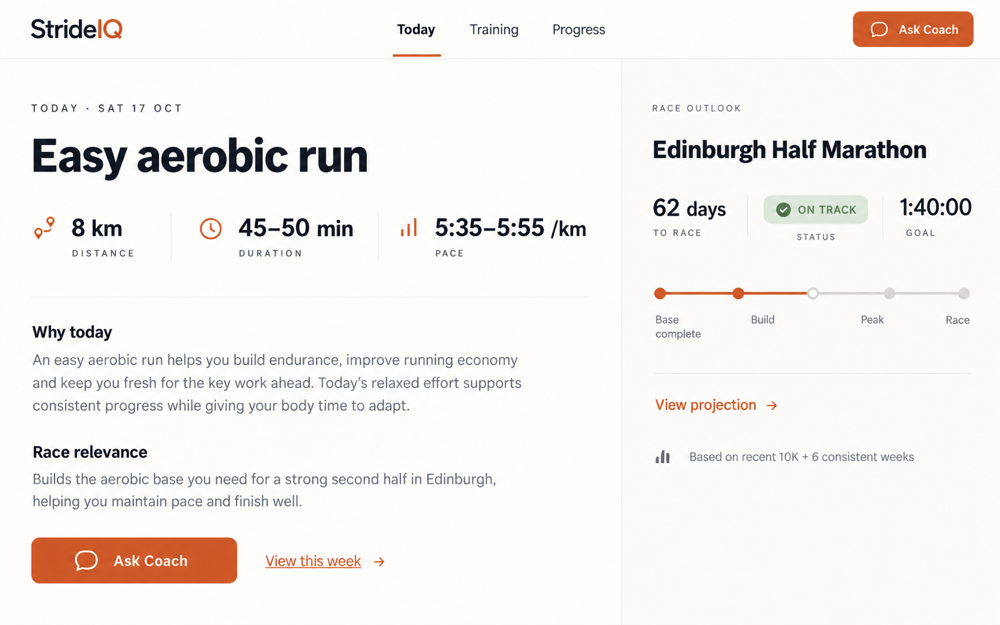
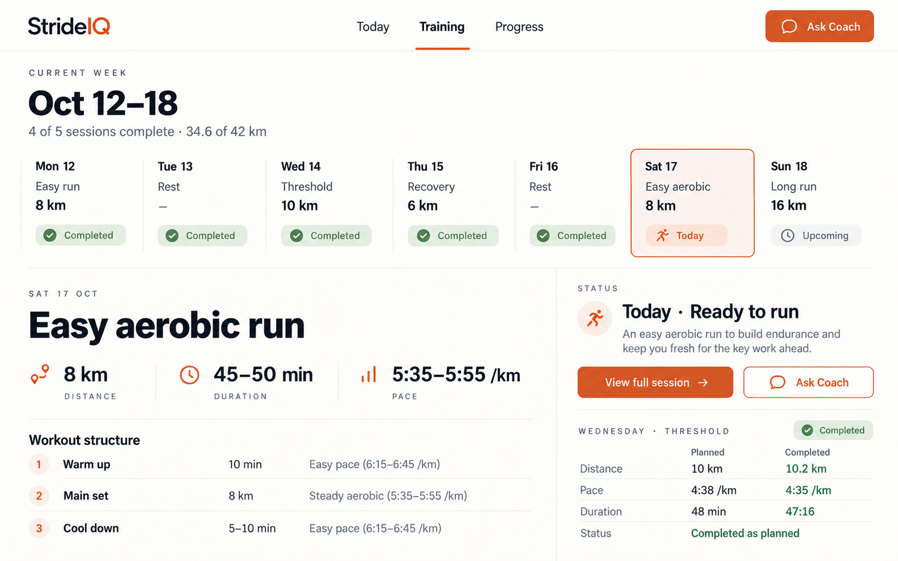
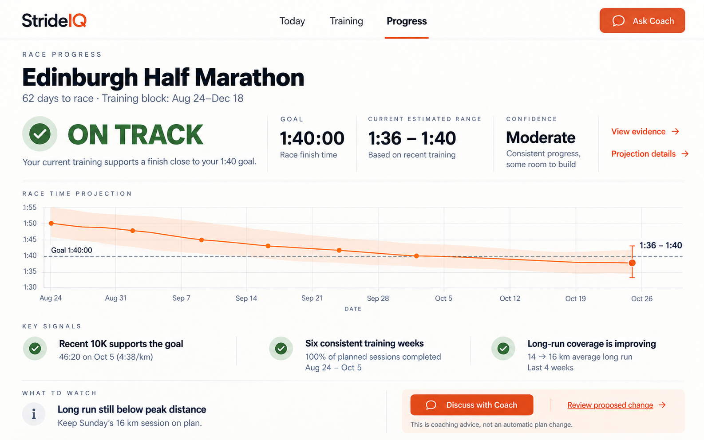
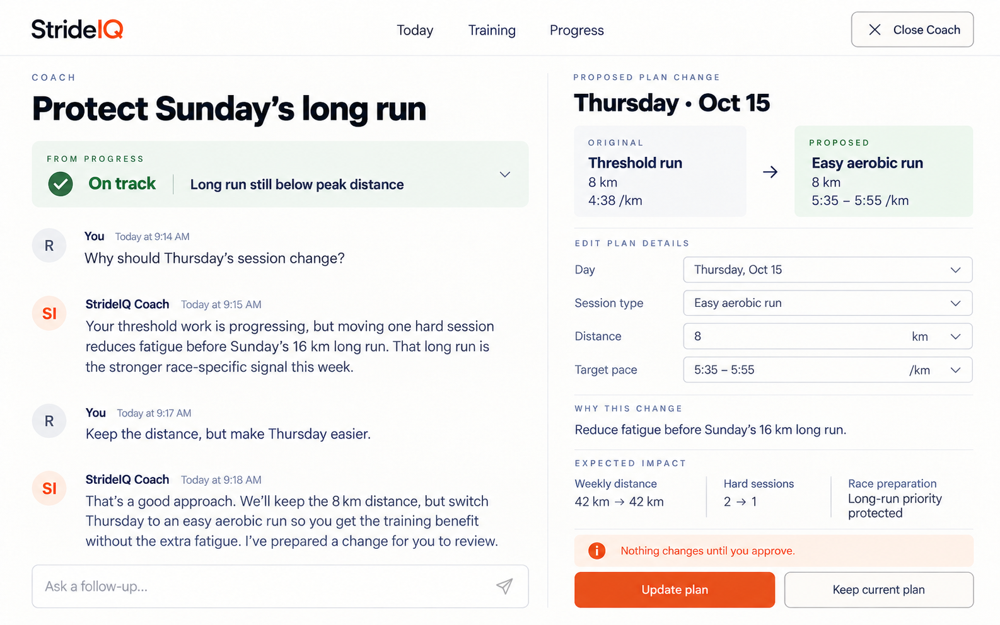

# StrideIQ UI overhaul specification

**Status:** Approved direction  
**Primary platform:** Desktop-led, mobile-complete  
**Reference date:** 17 October 2026

## 1. Purpose

This specification restructures StrideIQ around the questions runners actually arrive with:

1. What should I do today?
2. What does the rest of my week look like?
3. Am I on track for my race goal?
4. Why is StrideIQ recommending this, and what can I change?

The overhaul replaces the current dashboard's equal-weight collection of metrics, insights and repeated actions with a focused product hierarchy. It preserves analytical depth, but moves that depth behind clear, intentional paths.

This is a structural and interaction specification. The mockups establish hierarchy and visual direction; they are not immutable pixel specifications.

## 2. Current experience: primary problems

- Home presents too many signals with similar visual weight.
- The most important answer—what to run today—does not dominate the page.
- Small typography and compressed content reduce readability on desktop.
- Multiple Coach links compete with one another without clarifying context.
- Readiness, fitness, race projection, recent changes, risks and opportunities appear together without a clear decision order.
- Technical metrics are exposed before their relevance is established.
- “Intelligence” is an ambiguous destination label.
- The system does not clearly distinguish computed training data, conversational advice and confirmed plan changes.

## 3. Product principles

### 3.1 Decision first

Every primary screen must answer one question before presenting supporting evidence.

- **Today:** What should I do now?
- **Training:** What is planned, and what actually happened?
- **Progress:** Am I on track for my goal?
- **Coach:** Why, and what could change?

### 3.2 Calm overview, technical depth

The default experience should be calm and directive. Analytical depth is available through progressive disclosure rather than displayed permanently.

### 3.3 Exceptions earn attention

Readiness and fatigue appear on Today only when they materially affect the recommendation. Healthy or neutral data should not create permanent dashboard furniture.

### 3.4 Honest uncertainty

StrideIQ must not manufacture confidence. It may show **Ahead**, **On track**, **At risk** or **Not enough evidence**. Finish projections use ranges, evidence and confidence—not unexplained precise numbers.

### 3.5 Conversation cannot silently change the plan

The LLM may explain, explore and propose. The fixed plan changes only after the runner reviews structured before-and-after data and explicitly selects **Update plan**.

### 3.6 Desktop-led, mobile-complete

Desktop is the primary planning and analysis environment. Mobile preserves every core workflow, but reorganizes information rather than shrinking desktop layouts.

## 4. Information architecture

### 4.1 Global navigation

The primary navigation contains three destinations:

1. **Today**
2. **Training**
3. **Progress**

**Ask Coach** is a persistent global action, not a fourth content destination. It carries context from the current page.

Examples:

- From Today: ask about today's prescription.
- From Training: adjust a session or week.
- From Progress: explain a projection, risk or recommendation.
- From a completed activity: analyse planned versus actual performance.

### 4.2 Page hierarchy

```text
Today
├── Today's prescription or recovery guidance
├── Contextual Ask Coach action
├── Race outlook or recent progress
└── Conditional warning when readiness changes the recommendation

Training
├── Current week
├── Selected-day detail
├── Planned-versus-completed comparison
├── Future plan
└── Activity history

Progress
├── Race status
├── Explainable finish-time projection
├── Fitness trajectory
├── Training sustainability
└── One recommended adjustment

Coach
├── Source context
├── Conversation
├── Structured proposal when relevant
└── Explicit plan verification and update
```

## 5. Global visual direction

### 5.1 Character

Use a hybrid visual system:

- Calm coaching on Today
- Structured planning on Training
- Transparent analytical depth on Progress
- Conversational warmth with system-level precision in Coach

The product should feel credible, composed and athletic—not like a generic SaaS dashboard or an AI chat wrapper.

### 5.2 Layout

- Use top navigation rather than a permanent sidebar.
- Constrain desktop content to approximately 1,280–1,440 px.
- Use whitespace and typographic scale to establish hierarchy.
- Avoid a grid of equally styled cards.
- Prefer section boundaries, subtle tints and spacing over repeated borders and shadows.
- Use CSS Grid for primary desktop compositions.

### 5.3 Typography

- Use a distinctive, highly legible variable sans such as Geist, Satoshi or an equivalent brand typeface.
- Large page and session headings use tight tracking and compact line-height.
- Body copy should remain within roughly 65 characters per line.
- Metrics use tabular figures.
- Use medium and semibold weights to create hierarchy without relying only on size.
- Technical labels may use restrained uppercase with increased letter spacing; prose headings use sentence case.

### 5.4 Colour

- Warm off-white base
- Charcoal primary text
- One muted orange/copper brand accent
- Soft sage for positive status
- Amber for caution
- Restrained red only for genuine risk or destructive actions
- Never communicate status using colour alone
- Avoid decorative gradients, glass effects and saturated multi-colour dashboards

### 5.5 Interaction

- All interactive elements require hover, pressed and visible keyboard-focus states.
- Use 200–300 ms transitions based on opacity and transform.
- Respect `prefers-reduced-motion`.
- Skeletons should resemble the content they replace.
- Validation and errors appear inline; do not use browser alerts.

## 6. Today



### 6.1 Primary job

Answer **“What should I do today?”** within five seconds.

### 6.2 Desktop composition

Use a 65/35 two-column layout above the fold.

**Primary column:** today's prescription  
**Secondary column:** race outlook, or recent progress when no race exists

### 6.3 Today's prescription hierarchy

1. Session type
2. Distance
3. Estimated duration
4. Target pace or effort
5. Why this session was chosen
6. How it supports the race goal

The primary contextual action is **Ask about this run**. It opens the full Coach experience with the session context attached.

**View this week** is a quieter secondary action leading to Training.

The global header retains **Ask Coach** for questions not necessarily tied to the session.

### 6.4 Race configured

The secondary column contains:

- Race name
- Days remaining
- Direct status
- Goal finish time
- Link to projection details
- Short evidence provenance, such as “Based on recent 10K + 6 consistent weeks”

### 6.5 No race configured

Replace race outlook with a recent-progress summary:

- Current training direction
- Short fitness trajectory
- One evidence-based observation
- Action to configure a race goal, without blocking general training

### 6.6 Rest day

Rest is an intentional prescription, not an empty state. Show:

- **Recovery day** as the primary heading
- Mobility guidance
- Sleep guidance
- Fueling or hydration guidance when relevant
- Why recovery is appropriate today
- Optional preview of tomorrow's session

### 6.7 Readiness and fatigue

Do not show routine readiness metrics by default.

Surface a readiness warning only when it materially changes today's recommendation. The warning must state:

- What changed
- Which evidence triggered it
- What StrideIQ recommends now
- An action to discuss the change with Coach

### 6.8 Today acceptance criteria

- The session type, distance, duration and pace are visible without scrolling at standard desktop sizes.
- A runner can reach the full week in one action.
- Coach opens with the current session attached.
- Routine readiness does not occupy permanent space.
- Rest days provide positive, actionable recovery guidance.
- The mobile layout presents prescription first, followed by race/progress context.

## 7. Training



### 7.1 Primary job

Show the current week and make the relationship between planned and completed work immediately clear.

### 7.2 Default view

Training always opens on the current week.

The desktop experience uses a hybrid layout:

1. Compact seven-day strip
2. Spacious selected-day detail below

### 7.3 Seven-day strip

Each day shows:

- Day and date
- Session type as the title
- Distance or duration
- Workout status
- Completed versus planned state when applicable

Statuses:

- Today
- Upcoming
- Completed as planned
- Completed with variance
- Changed
- Skipped
- Rest

Target pace belongs in the selected-day detail rather than every narrow day cell unless future testing shows a clear scanning benefit.

### 7.4 Selected-day behavior

The lower detail region always reflects the selected day.

**Upcoming or current session:**

- Full prescription
- Distance and duration
- Pace or effort
- Workout structure
- Why it belongs in the week
- View full session
- Ask Coach

**Completed session:**

- Planned versus completed distance
- Planned versus completed pace or effort
- Planned versus completed duration
- Completion status
- Material variance explanation
- Link to full activity detail

Do not display an unrelated completed-session comparison while another day is selected; the approved mockup is a visual shorthand only.

### 7.5 Current-week summary

Show concise weekly progress:

- Sessions completed versus planned
- Distance or duration completed versus planned
- One status summary when needed

Avoid permanent load scores in the weekly header.

### 7.6 Editing

- Selecting a future session enables view and edit actions.
- Direct edits use structured controls.
- Coach may propose broader changes, but those follow the verification flow in section 9.
- Reordering or changing a session must show affected weekly totals before save.

### 7.7 Mobile behavior

- The seven-day strip becomes horizontally scrollable with Today initially in view.
- The selected-day detail is placed directly below the strip.
- Do not compress all seven days into narrow columns.
- Preserve status labels and planned-versus-actual comparison.

### 7.8 Training acceptance criteria

- The current day and current-week completion state are identifiable without reading every cell.
- Selecting any day updates the detail region.
- Completed days show planned-versus-actual data.
- Future days show the full prescription.
- Weekly totals update before a proposed edit is confirmed.
- The mobile layout does not require horizontal page scrolling outside the intentional week strip.

## 8. Progress



### 8.1 Primary job

Answer **“Am I on track for my race goal?”** honestly and explainably.

Supporting questions appear in this order:

1. Am I improving?
2. Is the training sustainable?
3. What is working, and what should change?

### 8.2 Adaptive time horizon

- With a race configured: use the current training block through race day.
- Without a race: default to the most recent 12 weeks.
- Allow manual range changes without making them the primary interaction.

### 8.3 Direct race status

Allowed statuses:

- **Ahead**
- **On track**
- **At risk**
- **Not enough evidence**

Status must never be based on motivational language alone. It is derived from the goal relative to the model's estimated finish range and confidence.

### 8.4 Healthy-state overview

Show:

- Direct status
- One-sentence explanation
- Goal time
- Current estimated finish range
- Confidence level
- Race projection over time
- Three strongest supporting signals
- One item to watch, when applicable

### 8.5 Adaptive disclosure

**Strong, healthy evidence:** concise summary  
**Uncertain evidence:** expose missing and conflicting signals  
**At risk:** explain the cause, evidence and one recommended adjustment  
**Not enough evidence:** state what data is missing and what could establish a useful baseline

Full analysis must always remain available.

### 8.6 Projection chart

The default healthy-state chart is race projection over time.

It shows:

- Central estimate
- Uncertainty band
- Goal reference line
- Latest estimated range
- Dates of material model updates

Because a lower finish time is better, the chart must use labels, tooltips and explanatory copy that prevent axis-direction confusion.

### 8.7 Projection methodology

The numerical model calculates the estimate. The language model may explain the result but must not invent or alter it.

Recommended explainable model layers:

1. **Performance baseline:** recent race or valid time-trial performance.
2. **Individual distance conversion:** use a personal power/fatigue model when enough history exists; otherwise use a clearly disclosed population baseline.
3. **Distance readiness:** weekly volume, longest-run coverage and relevant workout completion.
4. **Training continuity:** consistent weeks and material disruptions.
5. **Confidence:** input recency, distance similarity, sample count and data quality.

Reference research:

- [Individual athletic performance models](https://journals.plos.org/plosone/article?id=10.1371%2Fjournal.pone.0157257)
- [Training volume and longest run associations](https://pubmed.ncbi.nlm.nih.gov/32421886/)
- [Performance cost of training disruptions](https://www.frontiersin.org/journals/sports-and-active-living/articles/10.3389/fspor.2022.1096124/full)

### 8.8 View evidence

Use two levels:

1. **Inline evidence summary:** fastest explanation without leaving Progress.
2. **Projection details:** dedicated audit page containing inputs, dates, model contribution, uncertainty, assumptions and limitations.

Every evidence input must indicate:

- Source
- Date or date range
- Whether it strengthened, weakened or did not materially affect the projection
- Data-quality caveats

### 8.9 At-risk recommendation

When the status is At risk:

- Explain the primary reason.
- Recommend exactly one concrete training adjustment.
- Use **Discuss with Coach** as the primary action.
- Use **Review proposed change** as the secondary action when a structured proposal already exists.
- Do not change the plan from Progress.

### 8.10 No-race state

When no race exists, Progress answers “Am I getting fitter?” using:

- Fitness trajectory
- Training consistency
- Sustainable load trend
- Recent performance evidence
- Clear action to set a race goal when the runner wants goal-specific projection

### 8.11 Progress acceptance criteria

- The direct status and its reason are visible before any technical metrics.
- Every projection displays a range and confidence.
- The runner can inspect the evidence and methodology.
- Weak data produces Not enough evidence rather than false precision.
- At-risk states recommend one action rather than a list of generic opportunities.
- No LLM output can directly write a projected time into the fixed analytics state.

## 9. Coach



### 9.1 Role

Coach explains, explores and proposes. It does not silently modify the runner's confirmed plan or computed analytics.

### 9.2 Adaptive context

- Simple workout questions use a compact, expandable context banner.
- Plan comparisons, projection issues and proposed changes use a persistent side panel.
- The source context remains inspectable throughout the conversation.

### 9.3 Contextual history

Do not create a generic list of anonymous chat threads.

- Workout conversations live with the workout.
- Weekly-plan conversations live with that week.
- Projection conversations live with the relevant Progress assessment.
- Users may start fresh or remove a conversation.

### 9.4 Proposal creation

If a conversation results in a possible plan change, Coach creates a structured proposal containing:

- Original session
- Proposed session
- Reason for the change
- Changed fields
- Weekly distance before and after
- Weekly intensity before and after
- Other affected sessions
- Effect on race preparation

The proposal must be represented as validated application data, not parsed from displayed prose.

### 9.5 Editing a proposal

Users may edit with direct controls:

- Day
- Session type
- Distance or duration
- Target pace or effort
- Selected workout structure fields

Users may also ask Coach for broader revisions. Direct controls provide precision; conversation supports intent and trade-offs.

Every edit recalculates totals and downstream effects before approval.

### 9.6 Verification boundary

Display the statement **“Nothing changes until you approve.”** near the final actions.

Final actions:

- **Update plan** — explicit confirmation that writes the structured proposal into the fixed plan
- **Keep current plan** — dismisses or archives the proposal without mutation

Conversation alone must never invoke the final update.

### 9.7 Failure states

- If Coach fails, the confirmed plan and analytics remain unaffected.
- If proposal validation fails, show the invalid field and preserve the conversation.
- If the underlying plan changes during a conversation, mark the proposal stale and require regeneration or review.
- If a proposed date conflicts with another session, explain the conflict before approval.

### 9.8 Coach acceptance criteria

- Coach always identifies the context it received.
- Structured proposals are visually and technically distinct from chat messages.
- Users can edit proposals directly or conversationally.
- Totals and downstream effects update before approval.
- Plan changes require an explicit Update plan action.
- Failed or abandoned conversations cannot mutate the plan.

## 10. Responsive behavior

### 10.1 Desktop

- Primary target width: 1,280–1,440 px content container.
- Today uses 65/35 columns.
- Training uses the full-width week strip and lower detail grid.
- Progress uses full-width status and projection regions.
- Coach uses conversation/proposal split view.

### 10.2 Tablet

- Preserve two columns where content remains readable.
- Allow Coach's proposal panel to become a resizable or modal-like sheet only when necessary.
- Training week strip may scroll horizontally.

### 10.3 Mobile

- Navigation becomes a compact bottom or top-level three-item control; Ask Coach remains reachable without obscuring content.
- All split views stack in decision order.
- Coach proposal opens as a dedicated review step rather than a narrow side panel.
- Projection charts support horizontal inspection without causing page overflow.
- Primary controls meet a minimum 44 × 44 px target.
- Sticky actions must not cover important content or operating-system safe areas.

## 11. System states

Every primary screen requires:

- Loading skeleton
- Empty state
- Partial-data state
- Inline error state
- Offline or stale-data state where applicable
- Last-updated indicator for analytics

Specific empty states:

- **Today:** no plan yet; explain the next step and offer plan generation.
- **Training:** no current week; offer generation with relevant context.
- **Progress:** insufficient history; explain which activity or race data is required.
- **Coach:** no context; provide a plain question input without fabricating athlete context.

## 12. Content standards

- Use direct, specific language.
- Avoid hype, exclamation marks and vague AI terminology.
- Never label a statistical association as a certainty.
- Use “estimated range,” not “predicted exact finish.”
- Use “based on” to expose provenance.
- Recommendations must state both the action and the reason.
- Errors state what happened and what the runner can do next.

Preferred examples:

- “On track. Your recent 10K and six consistent weeks support the goal.”
- “Not enough evidence. Add a recent 5K, 10K or time trial to establish a baseline.”
- “At risk. Two disrupted weeks reduced long-run coverage. Protect Sunday's 16 km session.”

## 13. Accessibility

- Meet WCAG 2.2 AA contrast requirements.
- Provide a skip-to-content link.
- Use semantic landmarks and heading order.
- Do not encode Ahead, On track or At risk using colour alone.
- Give charts a text summary and accessible data table.
- Announce selection changes and recalculated plan totals to assistive technology.
- Maintain visible focus rings.
- Support keyboard navigation through the week strip and proposal fields.
- Respect reduced motion and increased text size.

## 14. Instrumentation and evaluation

Measure whether the hierarchy improves usability:

- Time from opening Today to identifying today's prescription
- Today → Training navigation rate
- Session-level Ask Coach usage
- Progress evidence expansion rate
- Projection-detail visits
- Coach proposal review completion
- Proposal edit rate
- Update plan versus Keep current plan rate
- Frequency of stale or invalid proposals
- Mobile task completion compared with desktop

Qualitative testing prompts:

1. “What should you do today?”
2. “Why has StrideIQ chosen this session?”
3. “Show me what you have completed this week.”
4. “Are you on track for your race goal?”
5. “What evidence supports that assessment?”
6. “Ask Coach to make Thursday easier without changing weekly distance.”
7. “Confirm that the plan has not changed before approval.”

## 15. Implementation sequence

### Phase 1 — Structure

- Replace the existing five-item navigation with Today, Training and Progress.
- Add persistent contextual Ask Coach.
- Recompose Today around the daily prescription.

### Phase 2 — Training

- Build the hybrid current-week strip.
- Add selected-day detail.
- Add planned-versus-completed comparison.

### Phase 3 — Progress

- Implement direct race status and honest insufficient-data state.
- Add projection range and confidence.
- Add explainable evidence summary and detail view.

### Phase 4 — Coach verification

- Attach structured page context to Coach.
- Persist contextual conversation history.
- Implement structured proposals, direct editing and recalculation.
- Require explicit Update plan approval.

### Phase 5 — Responsive and quality states

- Implement mobile compositions.
- Add loading, empty, partial, error and stale-data states.
- Complete accessibility and usability testing.

## 16. Out of scope for this overhaul

- Replacing the underlying training or projection algorithms
- Adding social/community features
- Building native watch interfaces
- Introducing a new frontend framework
- Rebranding StrideIQ beyond the visual-system refinements described here
- Allowing autonomous plan changes without runner approval

## 17. Definition of done

The overhaul is complete when:

- Today answers the daily training question within five seconds.
- Training makes the current week and planned-versus-actual status scannable.
- Progress states whether the runner is on track and exposes the evidence.
- Coach receives page context and produces structured, reviewable proposals.
- No conversational output can mutate the fixed plan without explicit verification.
- All core flows work on desktop and mobile.
- Loading, empty, partial, error and stale states are implemented.
- Keyboard and screen-reader workflows pass accessibility review.
- The implemented hierarchy matches the approved reference screens while adapting responsibly to real data.
